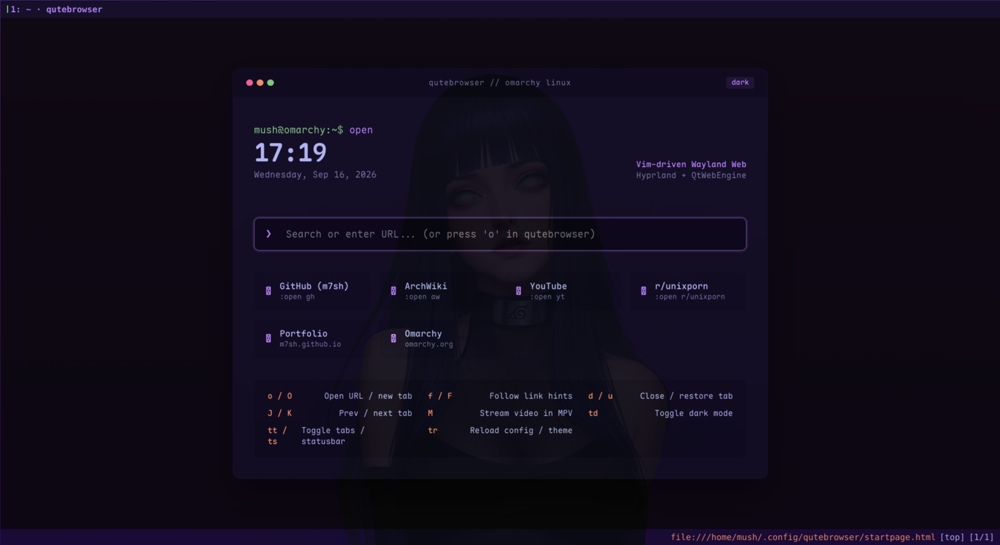

# 🌐 Omarchy Qutebrowser

> **Aesthetic, keyboard-driven Qutebrowser setup with dynamic Omarchy theme synchronization, solid opaque Wayland rendering, and a built-in terminal startpage.**

<p align="center">
  
</p>

<p align="center">
  
  
  
  
  
</p>

---

## ✨ Features

- 🎨 **Dynamic Omarchy Theme Sync**: Hooks directly into `omarchy theme set <theme>`. Whether you switch to *Velvet Dusk*, *Gruvbox*, *Catppuccin*, or *Everpuccin*, Qutebrowser immediately synchronizes all tab, statusbar, and UI colors via IPC without closing your tabs.
- ⚡ **Local Terminal Startpage**: A millisecond-fast local new tab dashboard with live system clock, formatted date, DuckDuckGo search bar, bookmark tiles, and a Vim cheat sheet.
- ⌨️ **Vim Keyboard Controls**: Seamless single-key navigation, quick hints, history management, and tab cycling.
- 🛡️ **Brave-Grade Ad & YouTube Blocking**: Uses **Brave's own `adblock-rust` engine** (via `python-adblock`) with Brave's default filter-list catalog, a hosts-file layer, DOM cosmetic element hiding, and dedicated YouTube video ad skipping & banner suppression.
- 🎬 **1-Key MPV Video Player**: Press <kbd>M</kbd> on any YouTube or video link (or <kbd>,</kbd><kbd>m</kbd> on any page) to stream directly in hardware-accelerated `mpv`.
- 🌙 **Native Dark Theme First**: Sites that ship a dark theme receive `prefers-color-scheme: dark`, so toggle switches, checkboxes and other form controls keep their intended styling. CIELAB forced inversion is still available as a fallback for light-only sites with <kbd>t</kbd><kbd>d</kbd>.

---

## 🚀 Quick Install (1-Line Command)

Run this single command in your terminal:

```bash
git clone https://github.com/m7sh/omarchy-qutebrowser.git /tmp/omarchy-qutebrowser && /tmp/omarchy-qutebrowser/install.sh && rm -rf /tmp/omarchy-qutebrowser
```

Or clone and run the installer manually:

```bash
git clone https://github.com/m7sh/omarchy-qutebrowser.git
cd omarchy-qutebrowser
./install.sh
```

### What the installer does:
1. Installs `qutebrowser` + `python-adblock` (Brave's engine) from the Arch/Omarchy repositories via `pacman`.
2. Deploys `config.py`, `brave_adblock.py`, `brave_cosmetics.py` and `brave-lists.txt` to `~/.config/qutebrowser/` (backs up existing `config.py`).
3. Pre-builds the adblock engine cache from the Brave list catalog, so blocking works on first launch.
4. Installs dynamic templates to `~/.config/omarchy/themed/`.
5. Installs the automated `theme-set.d` hook to `~/.config/omarchy/hooks/theme-set.d/`.
6. Generates the active palette for your current Omarchy theme immediately.
7. Registers the desktop launcher entry and icon.

---

## 🛠️ Manual Installation

If you prefer to configure manually:

### 1. Copy Qutebrowser Config & Brave Adblock Files
```bash
cp config.py brave_adblock.py brave_cosmetics.py brave-lists.txt ~/.config/qutebrowser/
```

Build the adblock cache (requires `python-adblock`):
```bash
python3 contrib/brave_adblock/build_cache.py --refresh
```

### 2. Copy Omarchy Theming Templates & Hook
```bash
mkdir -p ~/.config/omarchy/themed ~/.config/omarchy/hooks/theme-set.d
cp contrib/omarchy/qutebrowser-theme.py.tpl ~/.config/omarchy/themed/
cp contrib/omarchy/qutebrowser-startpage.html.tpl ~/.config/omarchy/themed/
cp contrib/omarchy/qutebrowser-theme ~/.config/omarchy/hooks/theme-set.d/
chmod +x ~/.config/omarchy/hooks/theme-set.d/qutebrowser-theme
```

### 3. Apply Your Current Theme
```bash
omarchy theme set "$(omarchy theme current)"
```

---

## 🛡️ Brave-Grade Ad Blocking

Qutebrowser's `content.blocking` backend is **Brave's own `adblock-rust` engine** (the Python `adblock` package). This setup plugs Brave's real filter catalog into it instead of qutebrowser's two-list default, so the blocking decisions come from the same rules Brave ships.

The catalog in [`brave-lists.txt`](./brave-lists.txt) mirrors the default-enabled entries of Brave's [`list_catalog.json`](https://github.com/brave/adblock-resources/blob/master/filter_lists/list_catalog.json):

| Layer | What it adds |
| :--- | :--- |
| Brave Default | uBlock Origin filters + yearly lists, EasyList, URLhaus, Brave Specific/Social/SugarCoat |
| Brave Privacy | EasyPrivacy + uBO Privacy |
| Brave First Party | `brave-firstparty.txt` + regional first-party rules |
| Cookie Notices | Fanboy Cookie + uBO Cookie + Brave cookie rules |
| Hosts layer | StevenBlack hosts (second net for trackers missing from ABP lists) |

On top of network blocking, `brave_cosmetics.py` restores **cosmetic filtering**: it asks the same adblock-rust engine for the page's `hide_selectors`, `style_selectors` and generic `.class`/`#id` rules, then injects them as a `<style>` element. That is the element-hiding step qutebrowser's [FAQ](https://github.com/qutebrowser/qutebrowser/issues/5754) says is not implemented. Site-specific `$generichide` exceptions are honoured; a sentinel probe works around an adblock-rust 0.5.6 bug that otherwise reports `generichide` for every page.

**Updating lists**

- Press <kbd>t</kbd><kbd>a</kbd> (or run `:adblock-update`) to redownload every list and rebuild the engine.
- The installer pre-builds `~/.local/share/qutebrowser/adblock-cache.dat`, so blocking is active on first launch.
- Edit `~/.config/qutebrowser/brave-lists.txt` to add or comment out lists, then run `:adblock-update`.

**Honest limitations** — qutebrowser does not expose every Brave hook:

- `$redirect` resources and uBO scriptlets are parsed by the engine but not injected, because qutebrowser constructs the engine without Brave's resource component.
- `$csp` directives are not applied to responses.
- `$removeparam` URL rewriting is not performed.
- Cosmetic filtering covers CSS selectors; procedural filters (`:has-text`, `:xpath`) are ignored.
- Due to the adblock-rust `generichide` bug, generic complex selectors (anything that is not a plain `.class`/`#id` rule) can still be skipped on some pages; class/id element hiding is unaffected.

For everything else, all network blocking, element hiding, and tracking prevention use the exact same engine and lists Brave ships.

### 🎬 Dedicated YouTube Ad & Banner Elimination
Because YouTube streams video ads dynamically over media chunk connections (`googlevideo.com`) and updates its player DOM frequently:
- **Fast-Forward & Auto-Skip Engine**: Intercepts in-stream ad overlays, mutes audio, accelerates playback to 16×, and seeks to completion.
- **Cosmetic Banner Hiding**: Injects custom CSS rules hiding sidebar banners (`ytd-ad-slot-renderer`), top mastheads, and sponsored tiles.

---

## ⌨️ Keybindings Reference

| Key | Action | Description |
| :--- | :--- | :--- |
| <kbd>o</kbd> | `:open [url/search]` | Open URL or search in current tab |
| <kbd>O</kbd> | `:open -t [url/search]` | Open URL or search in a new tab |
| <kbd>f</kbd> / <kbd>F</kbd> | `:hint` | Show link hints to jump / open in background |
| <kbd>d</kbd> | `:tab-close` | Close active tab |
| <kbd>u</kbd> | `:undo` | Restore last closed tab |
| <kbd>J</kbd> / <kbd>K</kbd> | `:tab-prev` / `:tab-next` | Switch to previous / next tab |
| <kbd>M</kbd> | `:hint links spawn mpv` | Stream selected link hint directly in MPV |
| <kbd>,</kbd><kbd>m</kbd> | `:spawn mpv {url}` | Stream current webpage video in MPV |
| <kbd>;</kbd><kbd>m</kbd> | `:hint --rapid links` | Rapid multi-video streaming in MPV |
| <kbd>t</kbd><kbd>d</kbd> | `darkmode toggle` | Toggle forced dark-mode fallback (sites use their native dark theme by default) |
| <kbd>t</kbd><kbd>t</kbd> | `tabs toggle` | Toggle tab bar visibility |
| <kbd>t</kbd><kbd>s</kbd> | `statusbar toggle`| Toggle status bar visibility |
| <kbd>t</kbd><kbd>r</kbd> | `:config-source` | Reload config and the active Omarchy theme |
| <kbd>t</kbd><kbd>a</kbd> | `:adblock-update` | Redownload Brave filter lists and rebuild the adblock engine |
| <kbd>Esc</kbd> | `cancel` | Clear search selection and return to normal mode |

---

## 🔍 Built-in Search Engines

Use quick prefixes with `:open`:

- `:open gh <search>` — Search **GitHub**
- `:open aw <search>` — Search **ArchWiki**
- `:open yt <search>` — Search **YouTube**
- `:open r <subreddit>` — Open **Subreddit** (e.g. `:open r unixporn`)
- `:open g <search>` — Search **Google**
- `:open w <search>` — Search **Wikipedia**
- `:open om <search>` — Search **Omarchy**
- `:open <search>` — Default search with **DuckDuckGo**

---

## 👤 Author

**Mohammed Musharaf (m7sh)**
- GitHub: [@m7sh](https://github.com/m7sh)
- Portfolio: [m7sh.github.io/m7sh/](https://m7sh.github.io/m7sh/)

---

## 📄 License

[MIT License](LICENSE) © 2026 Mohammed Musharaf
